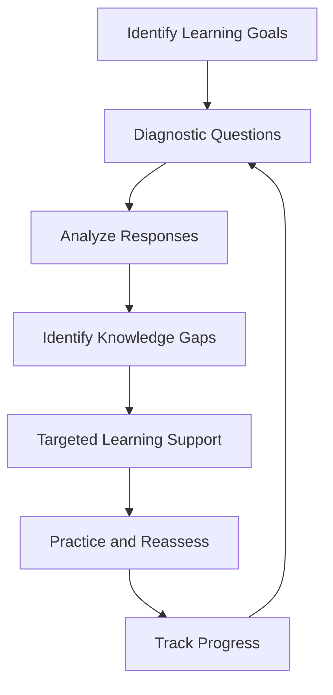

# Capacity-Test — AI-Driven Personalized Learning Platform

**Nurturing Confidence using AI**

Capacity-Test is an AI-driven educational platform designed to help learners improve through diagnostic assessment, targeted practice, personalized learning support, and continuous progress assessment.

Started in 2018 as a machine-learning solution, the platform has evolved into an AI-driven learning system focused on identifying knowledge gaps and helping learners concentrate on areas that need improvement.

**Role:** Platform Developer and AI/ML Solutions Engineer  
**Started:** 2018  
**Reported reach:** 100,000+ students  
**Focus:** AI in Education · Machine Learning · Personalized Learning · Learning Analytics

**Live Platform:** [capacity-test.com](https://capacity-test.com/)  
**Facebook:** [Capacity-Test](https://www.facebook.com/capacitytab)

---

## 1. Problem and Approach

Traditional learning can require students to work through extensive material before identifying what they do not understand. This can waste time and make it difficult to focus on individual learning needs.

Capacity-Test uses assessment and practice to help identify knowledge gaps, provide targeted learning support, and guide learners toward improvement.

The goal is not simply to test students, but to help them build subject mastery and confidence through purposeful practice.

## 2. Learning Cycle

*Conceptual workflow illustrating the learning approach, not the internal production architecture.*

## 3. Key Capabilities

### Diagnostic Assessment
Assess learners' understanding and identify areas that need improvement.

### Targeted Learning Support
Provide focused explanations and learning guidance to address identified gaps.

### Personalized Practice
Guide learners toward relevant practice based on their responses and learning needs.

### Progress Tracking
Track assessment inputs and study time to help monitor learner activity and progress.

### Confidence Building
Encourage improvement through structured practice, manageable learning steps, and reassessment.

### AI-Driven Learning
Apply AI capabilities to support responsive and personalized learning experiences.

## 4. Engineering and Product Development

My work on Capacity-Test spans the evolution of an educational technology product from an early machine-learning solution to an AI-driven platform.

Key engineering areas include:

- Applied machine learning and AI in education
- Assessment-driven learning workflows
- Web application and platform development
- Learner activity and progress tracking
- Personalized learning support
- Iterative product development and deployment

## 5. Development Evolution

Capacity-Test began in 2018 as an ML-based solution and has continued to evolve alongside advances in AI.

This progression demonstrates practical experience applying emerging technologies to an established product while maintaining its core educational objective.

## 6. Impact

Capacity-Test has a reported reach of **100,000+ students**.

Its central objective is to make learning more focused and effective by combining assessment, targeted support, and progress monitoring in a single learning experience.

## 7. Relevance to AI Engineering

Capacity-Test demonstrates experience applying AI/ML to a real-world product rather than treating AI as an isolated experiment.

The project involves:

- Translating an educational problem into a software solution
- Designing assessment-driven learning workflows
- Integrating AI capabilities into an existing product
- Supporting individual learning needs
- Evolving a deployed platform over multiple years

These experiences are relevant to AI Engineering and Forward Deployed Engineering, where technical solutions must address real user needs and practical operational requirements.

## 8. Confidentiality

Capacity-Test is a commercial platform. This repository documents the product's purpose, learning approach, and engineering contributions without publishing proprietary source code, private system configurations, or student records.

## 9. Links

- **Website:** https://capacity-test.com/
- **Facebook:** https://www.facebook.com/capacitytab

---

*Capacity-Test is an ongoing example of applying machine learning and AI to personalized learning, targeted practice, and learner confidence.*
